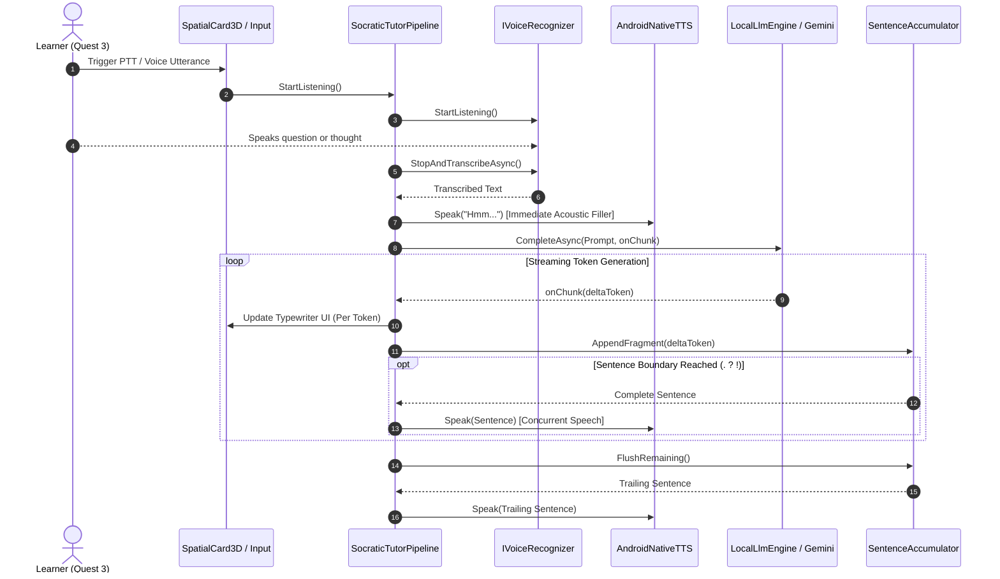
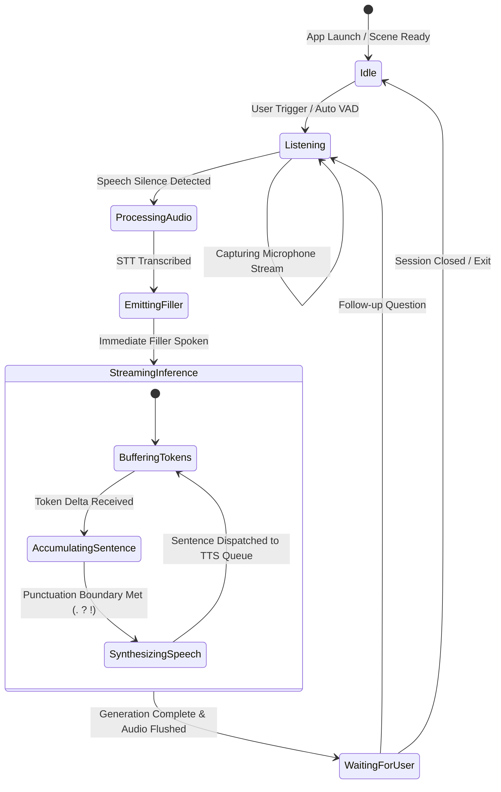
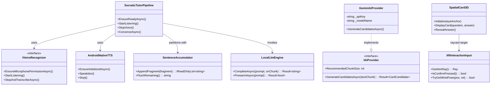

# System Architecture

## 1. High-Level System Flow

The diagram below illustrates how user speech captured in Meta Quest 3 flows through transcription, conversational latency masking, streaming LLM inference, sentence-boundary chunking, and spatial presentation.

---

## 2. Tutor Conversational State Machine

---

## 3. Class Structure & Layer Decoupling

The project follows Clean Architecture principles, ensuring that core algorithms and domains remain completely independent of Unity or hardware SDKs.

